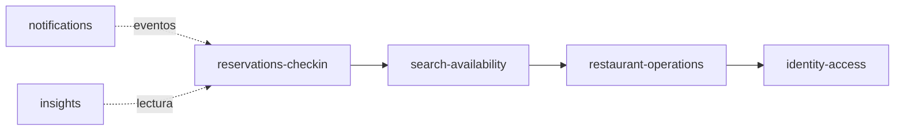
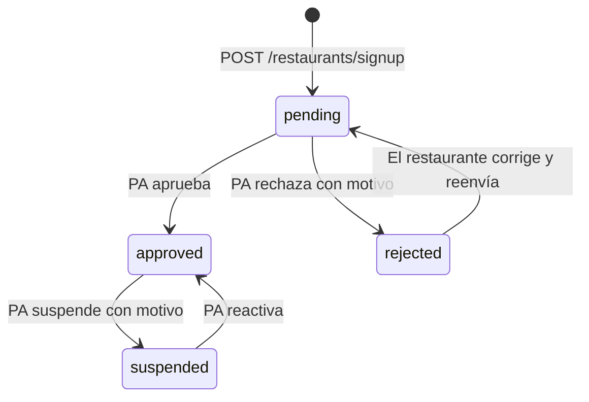
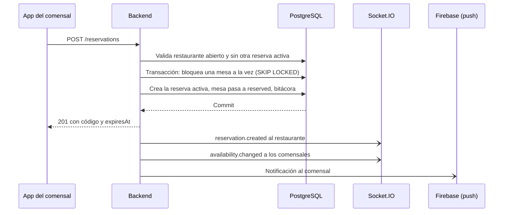
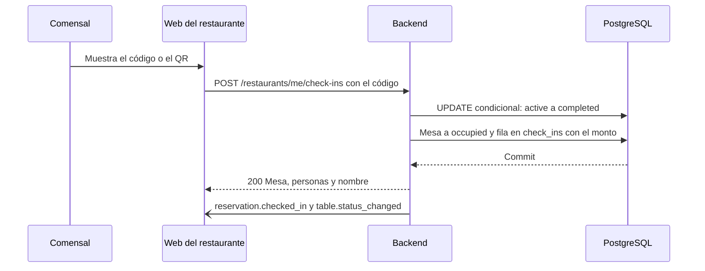
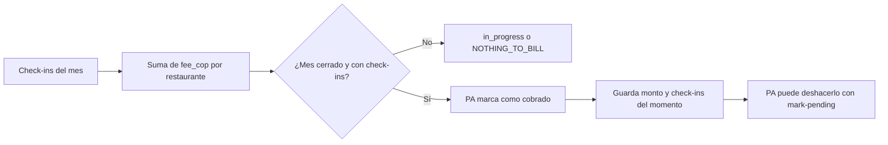
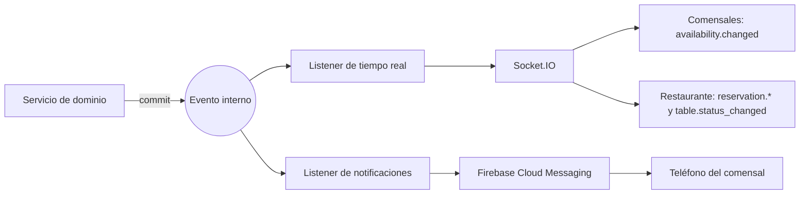

<div align="center">

# 📍 DiNNo · Backend

**Dile no a la espera.**
API REST y tiempo real para encontrar y asegurar una mesa disponible *ahora*.


</div>

## 📑 Contenido

| | | |
|---|---|---|
| [🧡 Qué es DiNNo](#-qué-es-dinno) | [🧩 Módulos](#-módulos) | [📁 Estructura](#-estructura-del-proyecto) |
| [🏗️ Arquitectura](#️-arquitectura) | [🛠️ Stack](#️-stack-tecnológico) | [🧪 Pruebas y calidad](#-pruebas-y-calidad) |
| [📡 API](#-api) | [📖 Referencia por endpoint](#-referencia-por-endpoint) | [🔄 Flujos](#-flujos-principales) |
| [🗄️ Modelo de datos](#️-modelo-de-datos) | [☁️ Despliegue](#️-despliegue) | [🔒 Concurrencia y seguridad](#-concurrencia-y-seguridad) |
| [🚀 Empezar en local](#-empezar-en-local) | [👥 Equipo](#-equipo) | |

---

## 🧡 Qué es DiNNo

DiNNo es un servicio de **microreservas para restaurantes**. El comensal encuentra en la app móvil un restaurante con mesa disponible en este momento y la asegura mientras llega; el restaurante administra sus mesas desde la app web y confirma la llegada con un *check-in*.

- 💸 Se cobra por **comensal** con check-in (tarifa configurable; por defecto **COP 1.500**).
- 📍 Piloto en la **Calle 72, Bogotá**.
- ⏱️ La reserva dura un tiempo limitado y vence sola.

Este repositorio es el **backend**: la API que usan la [app móvil del comensal](https://github.com/DiNNo-team/mobile) y la [plataforma web del restaurante](https://github.com/DiNNo-team/frontend).

### 👥 Quién usa qué

| Actor | Qué hace | Cliente |
|---|---|---|
| 🍽️ **Comensal** (`diner`) | Busca restaurantes con disponibilidad, reserva, cancela y recibe notificaciones | App móvil |
| 🏪 **Administrador de restaurante** (`restaurant_admin`) | Administra mesas y plano, abre o cierra, hace check-in, consulta reportes e informe de IA | App web |
| 🛡️ **Administrador de plataforma** (`platform_admin`) | Aprueba, rechaza y suspende restaurantes; ve métricas y gestiona el cobro mensual | App web |

### 🎭 Casos de uso

<div align="center">


*Casos de uso de DiNNo por tipo de actor.*

</div>

### ✨ Funcionalidades

- Registro de restaurantes con **revisión y aprobación** por la plataforma.
- Gestión de **mesas, zonas, plano y bitácora** de cambios.
- **Búsqueda** por ubicación, categoría y número de personas, con disponibilidad en tiempo real.
- **Microreserva** con vigencia limitada, cancelación y vencimiento automático.
- **Check-in** por código o QR y cobro por comensal.
- **Reportes** del restaurante, panel del administrador y cobro mensual.
- **Informe de IA** con recomendaciones de los últimos 7 días (Claude).
- **Notificaciones push** y actualizaciones por **WebSocket**.

---

## 🏗️ Arquitectura

Monolito modular en **NestJS**: una sola aplicación desplegable, organizada en seis módulos con fronteras claras. Un único despliegue, transacciones locales sobre una sola base de datos y comunicación interna sin latencia de red.

<div align="center">


*Diagrama de contexto (C4): quién usa DiNNo y con qué servicios externos se comunica el backend.*


*Arquitectura de referencia de DiNNo en Microsoft Azure.*

</div>

> [!NOTE]
> El diagrama muestra la arquitectura de referencia, con varias réplicas y alta disponibilidad. El piloto opera con una réplica y PostgreSQL B1ms (ver [Despliegue](#-despliegue)).

### 🔌 Cómo se comunican las piezas

| Canal | Uso |
|---|---|
| **REST** sobre HTTPS (`/v1`) | Todas las operaciones de los clientes; token de Firebase en `Authorization: Bearer` |
| **WebSocket** (Socket.IO) | Disponibilidad en vivo para comensales; reservas y mesas para el restaurante |
| **Eventos internos** (EventEmitter2) | Desacoplan los módulos: publican tras confirmar la transacción y los *listeners* reaccionan |
| **Firebase Cloud Messaging** | Notificaciones push al comensal |
| **API de Claude** | Redacción del informe de IA a partir de métricas agregadas |
| **Google Geocoding API** | Direcciones a coordenadas |

### 🧱 Reglas de las fronteras

1. Las dependencias entre módulos **no tienen ciclos**.
2. La comunicación hacia atrás se hace con **eventos internos**.
3. Las reglas de negocio se expresan como **puertos** (interfaces) que cada módulo implementa.

Así, cualquier módulo puede extraerse a un servicio independiente sin reescribir los demás.

---

## 🧩 Módulos



| Módulo | Responsabilidad |
|---|---|
| 🔐 `identity-access` | Usuarios, verificación del token de Firebase, roles, aprobación y autenticación del WebSocket |
| 🏪 `restaurant-operations` | Perfil del restaurante, mesas, zonas, plano, bitácora, geocodificación y revisión por el administrador |
| 🔎 `search-availability` | Reglas de disponibilidad, búsqueda, detalle público, vigencia de reserva y gateway Socket.IO |
| 📅 `reservations-checkin` | Reserva, cancelación, vencimiento, check-in, cobro, reportes y panel del administrador |
| 🔔 `notifications` | Registro de dispositivos y notificaciones push (FCM) |
| 🤖 `insights` | Informe de IA del restaurante (solo lectura) |

Cada módulo separa **controladores, servicios, entidades, DTO, puertos y listeners**. Los servicios de dominio no conocen el gateway ni el proveedor de notificaciones: publican eventos y los listeners los reenvían.

---

## 🛠️ Stack tecnológico

| Capa | Tecnología |
|---|---|
| Entorno | Node.js 24 (ESM) · TypeScript 6 |
| Framework | NestJS 12 (common, core, config, typeorm, event-emitter, swagger) |
| Persistencia | TypeORM 1.1 · PostgreSQL 17 |
| Caché y contadores | Redis (ioredis 5) sobre Azure Managed Redis |
| Tiempo real | Socket.IO 4.8 |
| Autenticación y push | Firebase Authentication y Cloud Messaging (firebase-admin 14) |
| IA | Claude API (`@anthropic-ai/sdk`) |
| Seguridad | helmet · `@nestjs/throttler` · class-validator |
| Documentación | Swagger (OpenAPI) en `/docs` |
| Pruebas | Vitest · Supertest · socket.io-client · k6 |
| Calidad | oxlint · Prettier · TypeScript estricto |
| Nube y CI/CD | Azure Container Apps · ACR · Key Vault · GitHub Actions (OIDC) |

---

## 📡 API

Todas las rutas viven bajo **`/v1`** y la documentación interactiva está en **`/docs`** (Swagger).

> **Roles:** `RA` administrador de restaurante · `D` comensal · `PA` administrador de plataforma

<details>
<summary><b>🔐 identity-access</b></summary>

| Método | Ruta | Roles | Descripción |
|---|---|---|---|
| `GET` | `/me` | RA, D, PA | Identidad actual. Sin perfil → `403 PROFILE_REQUIRED` |
| `POST` | `/diners/me` | Cuenta Firebase verificada | Crea (201) o devuelve (200) el comensal |

</details>

<details>
<summary><b>🏪 restaurant-operations</b></summary>

| Método | Ruta | Roles | Descripción |
|---|---|---|---|
| `POST` | `/restaurants` | RA habilitado por el equipo | Registra el restaurante (nace `approved`) |
| `POST` | `/restaurants/signup` | Cuenta sin perfil | Crea usuario RA y restaurante `pending` en una transacción |
| `GET` `PATCH` | `/restaurants/me` | RA | Perfil y edición de datos, horarios y coordenadas |
| `POST` | `/restaurants/me/resubmit` | RA (rechazado) | Reenvía la solicitud |
| `GET` `PATCH` | `/restaurants/me/status` | RA | Abierto / cerrado |
| `POST` `GET` | `/tables` | RA aprobado | Crear y listar mesas |
| `PUT` | `/tables/plan` | RA aprobado | Reemplaza el plano completo |
| `PATCH` | `/tables/:id/status` | RA aprobado | Cambia estado; `409 TABLE_HAS_ACTIVE_RESERVATION` si hay reserva viva |
| `PATCH` | `/tables/:id` | RA aprobado | Edita identificador, capacidad o zona |
| `POST` | `/tables/:id/deactivate` · `/reactivate` | RA aprobado | Desactiva o reactiva |
| `GET` `POST` | `/table-areas` | RA aprobado | Listar y crear zonas |
| `PATCH` `DELETE` | `/table-areas/:id` | RA aprobado | Renombrar o eliminar zona |
| `GET` | `/table-logs?tableId=` | RA aprobado | Bitácora (hasta 200 filas) |
| `GET` | `/geocode?address=` | RA (también pendiente o rechazado), D, cuenta sin perfil con correo verificado | Dirección → coordenadas. `404 ADDRESS_NOT_FOUND` · `503 GEOCODING_UNAVAILABLE` |
| `GET` | `/admin/restaurants` · `/:id` | PA | Lista paginada y detalle |
| `POST` | `/admin/restaurants/:id/approve` · `reject` · `suspend` · `reactivate` | PA | Revisión del restaurante |

</details>

<details>
<summary><b>🔎 search-availability</b></summary>

| Método | Ruta | Roles | Descripción |
|---|---|---|---|
| `GET` | `/search/zones` | D | 20 zonas con coordenadas |
| `GET` | `/search/restaurants` | D | Búsqueda por ubicación o zona, radio (1, 2, 5 o 10 km), categoría y personas |
| `GET` | `/restaurants/:id/public` | D | Detalle público: horarios, `isOpenNow`, disponibilidad y vigencia |

</details>

<details>
<summary><b>📅 reservations-checkin</b></summary>

| Método | Ruta | Roles | Descripción |
|---|---|---|---|
| `POST` | `/reservations` | D | Crea la reserva. Errores 409: `NO_TABLE_AVAILABLE`, `ACTIVE_RESERVATION_EXISTS`, `RESTAURANT_CLOSED` |
| `GET` | `/reservations/active` | D | Reserva activa y hora del servidor |
| `GET` | `/reservations/:id` | D (propia) | Reserva en cualquier estado |
| `POST` | `/reservations/:id/cancel` | D (propia) | Cancela; `409 RESERVATION_NOT_ACTIVE` si ya no está activa |
| `POST` | `/restaurants/me/check-ins` | RA | Confirma la llegada con el código |
| `GET` | `/restaurants/me/reservations` · `/summary` | RA | Reservas, KPIs, mapa de calor y pago mensual |
| `GET` | `/restaurants/me/billing/check-ins` | RA | Estado de cuenta paginado |
| `GET` | `/admin/overview` · `/admin/billing` · `/admin/billing/:restaurantId` · `/admin/activity` · `/admin/platform/metrics` | PA | Panel de la plataforma |
| `POST` | `/admin/billing/:restaurantId/:month/mark-paid` · `mark-pending` | PA | Cobro mensual |

</details>

<details>
<summary><b>🔔 notifications · 🤖 insights · ❤️ salud</b></summary>

| Método | Ruta | Roles | Descripción |
|---|---|---|---|
| `PUT` `DELETE` | `/notifications/devices` | D | Registra o elimina el token del teléfono |
| `GET` | `/restaurants/me/insights?refresh=` | RA aprobado | Informe de IA (7 días frente a los 7 anteriores) |
| `GET` | `/health` | Público | Estado del servicio y commit desplegado |

</details>

### ⚡ Eventos

- **Internos** (EventEmitter2, tras confirmar la transacción): `reservation.created` · `reservation.cancelled` · `reservation.expired` · `reservation.checked_in` · `table.status-changed` · `restaurant.availability-affected`.
- **WebSocket** (Socket.IO): `availability.changed` (comensales) y `reservation.*` y `table.status_changed` (restaurante, o comensal en sus propias reservas).


### 📖 Referencia por endpoint

Cada ficha resume qué hace la ruta, qué recibe, qué responde y qué errores devuelve. El detalle de los campos está en Swagger (`/docs`).

> [!NOTE]
> **Comunes a toda ruta:** `401` sin sesión (token ausente, inválido o vencido) o con el correo sin verificar (`EMAIL_NOT_VERIFIED`) · `429` al pasar el límite de peticiones · `400` con la lista de mensajes si la entrada no es válida (cualquier campo que no esté en el contrato se rechaza). Todas las rutas llevan `Authorization: Bearer <token de Firebase>`, salvo `/health`.
>
> **Errores de cuenta (`403`):** `ACCOUNT_NOT_ENABLED` (cuenta sin perfil en una ruta de restaurante) · `PROFILE_REQUIRED` (sin perfil en una ruta de comensal) · `DINER_ACCOUNT` · `RESTAURANT_ACCOUNT` · `ADMIN_ACCOUNT` (rol equivocado) · `ACCOUNT_PENDING_APPROVAL` · `ACCOUNT_REJECTED` · `RESTAURANT_SUSPENDED` (restaurante sin aprobar o suspendido, en una ruta que no le corresponde) · `RESTAURANT_REQUIRED` (aún no registró su restaurante). Los clientes deciden por `errorCode`, nunca por el texto.

**Límites de peticiones por ruta** (ventana de 1 minuto, salvo donde se indica): `account` 20 · `signup` 10 cada 10 minutos · `reservation` 10 (crear y cancelar comparten contador) · `checkIn` 30 · `geocode` 20 · `ai` 10 · `adminReports` 30. Además, toda ruta tiene un límite global de 300 por cuenta y 1.000 por IP.

#### 🔐 Identidad y cuenta

<details>
<summary><b><code>GET /me</code></b> · Consultar la cuenta de la sesión</summary>

| | |
|---|---|
| **Roles** | RA, D, PA (también restaurantes pendientes, rechazados o suspendidos) |
| **Qué hace** | Devuelve quién es el usuario de la sesión y su rol. Es lo primero que llama cada cliente tras iniciar sesión |
| **Entrada** | Ninguna |
| **Respuesta `200`** | `{ id, email, displayName \| null, role, restaurantId \| null }` |
| **Errores** | `403 PROFILE_REQUIRED` si la cuenta de Firebase aún no tiene perfil |
| **Límite** | `account` |

</details>

<details>
<summary><b><code>POST /diners/me</code></b> · Crear el perfil de comensal</summary>

| | |
|---|---|
| **Roles** | Cuenta de Firebase con correo verificado |
| **Qué hace** | Crea el usuario con rol `diner`. Es idempotente: si ya existe como comensal, lo devuelve |
| **Entrada** | `{ displayName? }` (1 a 60 caracteres). Sin nombre, usa el de la cuenta de Google o la parte del correo antes de `@` |
| **Respuesta** | `201` si lo crea · `200` si ya existía. Misma forma que `GET /me` |
| **Errores** | `403 RESTAURANT_ACCOUNT` si el correo o el UID ya son de un restaurante |
| **Límite** | `account` |

</details>

#### 🏪 Restaurante: registro, aprobación y estado

<details>
<summary><b><code>POST /restaurants/signup</code></b> · Registro público del restaurante</summary>

| | |
|---|---|
| **Roles** | Cuenta sin perfil con correo verificado |
| **Qué hace** | En **una sola transacción** crea el usuario `restaurant_admin`, el restaurante en estado `pending`, sus horarios y el vínculo entre ambos |
| **Entrada** | `name`, `category`, `address`, `latitude?` + `longitude?` (dentro de Bogotá, las dos o ninguna), `schedules[]` y `contactPhone` (obligatorio, 7 a 15 dígitos) |
| **Respuesta `201`** | Perfil del restaurante con `approvalStatus: "pending"` |
| **Errores** | `403 DINER_ACCOUNT` · `403 ADMIN_ACCOUNT` · `409` si la cuenta ya registró su restaurante, o ya está habilitada como restaurante sin haberlo registrado |
| **Límite** | `signup` |

</details>

<details>
<summary><b><code>POST /restaurants</code></b> · Registrar el restaurante de una cuenta habilitada</summary>

| | |
|---|---|
| **Roles** | RA habilitado por el equipo, sin restaurante todavía |
| **Qué hace** | Registra el restaurante de un usuario que el equipo ya dio de alta. Nace `approved` |
| **Entrada** | Los campos del registro público; `contactPhone` es opcional |
| **Respuesta `201`** | Perfil del restaurante con `activeReservationsCount: 0` |
| **Errores** | `403 ACCOUNT_NOT_ENABLED` · `403 DINER_ACCOUNT` · `409` si ya registró su restaurante |
| **Límite** | `signup` |

</details>

<details>
<summary><b><code>GET /restaurants/me</code></b> · Consultar mi restaurante</summary>

| | |
|---|---|
| **Roles** | RA (también pendiente, rechazado o suspendido) |
| **Qué hace** | Devuelve el perfil del restaurante de la sesión: datos, coordenadas, horarios, estado de aprobación y reservas activas |
| **Respuesta `200`** | Perfil con `approvalStatus`, `rejectionReason` (solo si está rechazado), `suspensionReason` (solo si está suspendido), `contactPhone` y `activeReservationsCount` |
| **Errores** | `403 RESTAURANT_REQUIRED` |

</details>

<details>
<summary><b><code>PATCH /restaurants/me</code></b> · Editar mi restaurante</summary>

| | |
|---|---|
| **Roles** | RA aprobado, pendiente o rechazado (no suspendido) |
| **Qué hace** | Edita nombre, categoría, dirección, coordenadas, horarios o teléfono. **Nunca cambia el estado de aprobación**. Si cambian los horarios o las coordenadas, avisa a los comensales por WebSocket |
| **Entrada** | Al menos uno de los campos del registro; los que no se envían no cambian |
| **Respuesta `200`** | Perfil actualizado |
| **Errores** | `400` si el cuerpo está vacío o los horarios no son válidos · `403 RESTAURANT_REQUIRED` |

</details>

<details>
<summary><b><code>POST /restaurants/me/resubmit</code></b> · Reenviar una solicitud rechazada</summary>

| | |
|---|---|
| **Roles** | RA rechazado |
| **Qué hace** | Pasa el restaurante de `rejected` a `pending`, borra el motivo y la revisión, y lo manda al final de la fila de solicitudes. Es **una sola sentencia condicional**: con reenvíos simultáneos gana uno |
| **Entrada** | Ninguna |
| **Respuesta `200`** | Perfil con `approvalStatus: "pending"` |
| **Errores** | `409 RESTAURANT_NOT_REJECTED` |
| **Límite** | `signup` |

</details>

<details>
<summary><b><code>GET /restaurants/me/status</code></b> y <b><code>PATCH /restaurants/me/status</code></b> · Abierto o cerrado</summary>

| | |
|---|---|
| **Roles** | `GET`: RA (también pendiente, rechazado o suspendido) · `PATCH`: RA aprobado |
| **Qué hace** | `GET` consulta si el restaurante está abierto. `PATCH` lo abre o lo cierra. Cerrar **no cancela** las reservas activas: se respetan hasta el check-in o el vencimiento, y no se aceptan nuevas |
| **Entrada** | `PATCH`: `{ isOpen: boolean }` |
| **Respuesta `200`** | `{ isOpen, approvalStatus, suspensionReason }` (`GET`) · `{ isOpen }` (`PATCH`) |
| **Notas** | El `PATCH` es un `UPDATE` condicional: pedir el estado que ya tiene responde `200` sin escribir ni emitir eventos |

</details>

<details>
<summary><b><code>GET /geocode?address=</code></b> · Ubicar una dirección de Bogotá</summary>

| | |
|---|---|
| **Roles** | RA (también pendiente o rechazado), D y cuenta sin perfil con correo verificado |
| **Qué hace** | Convierte una dirección en coordenadas con Google Geocoding, restringido a Bogotá. Lo usa el formulario de registro antes de que exista la cuenta |
| **Entrada** | `address` (3 a 255 caracteres) |
| **Respuesta `200`** | `{ latitude, longitude, formattedAddress }` (6 decimales) |
| **Errores** | `404 ADDRESS_NOT_FOUND` · `503 GEOCODING_UNAVAILABLE` (sin llave, cuota agotada o tiempo de espera) · `403 ADMIN_ACCOUNT` |
| **Límite** | `geocode` |

</details>

#### 🪑 Mesas, zonas, plano y bitácora

<details>
<summary><b><code>POST /tables</code></b> y <b><code>GET /tables</code></b> · Crear y listar mesas</summary>

| | |
|---|---|
| **Roles** | RA aprobado |
| **Qué hace** | Crea una mesa `available` o lista todas las del restaurante (activas e inactivas) por fecha de creación |
| **Entrada** | `POST`: `identifier` (hasta 10 caracteres), `capacity` (1 a 20) y `areaId?` |
| **Respuesta** | `201` con la mesa · `200` con la lista (`[]` si no hay) |
| **Errores** | `409` si el identificador ya existe (`"4"`, `"04"` y `"Mesa 4"` son la misma mesa) · `404` si la zona no existe o es de otro restaurante |
| **Notas** | Crear una mesa avisa a los comensales (puede cambiar la disponibilidad). No se registra en la bitácora |

</details>

<details>
<summary><b><code>PATCH /tables/:id/status</code></b> · Cambiar el estado de una mesa</summary>

| | |
|---|---|
| **Roles** | RA aprobado |
| **Qué hace** | Cambia la mesa entre `available`, `reserved` y `occupied`. Escribe en la bitácora y avisa por WebSocket |
| **Entrada** | `{ status }` |
| **Respuesta `200`** | La mesa actualizada. Pedir el estado que ya tiene responde `200` sin escribir nada |
| **Errores** | `404` · `409` si la mesa está inactiva · `409 TABLE_HAS_ACTIVE_RESERVATION` si hay una reserva de DiNNo en curso (también al pedir el estado que ya tiene) |

</details>

<details>
<summary><b><code>PATCH /tables/:id</code></b> · Editar una mesa</summary>

| | |
|---|---|
| **Roles** | RA aprobado |
| **Qué hace** | Cambia el identificador, la capacidad o la zona. Cambiar de zona saca la mesa del plano. No se registra en la bitácora |
| **Entrada** | Al menos uno de `identifier`, `capacity`, `areaId` |
| **Errores** | `404` · `409` por identificador repetido · `409 TABLE_HAS_ACTIVE_RESERVATION` solo si la nueva capacidad queda **por debajo** de las personas de la reserva en curso |

</details>

<details>
<summary><b><code>POST /tables/:id/deactivate</code></b> y <b><code>POST /tables/:id/reactivate</code></b> · Desactivar y reactivar</summary>

| | |
|---|---|
| **Roles** | RA aprobado |
| **Qué hace** | Desactiva una mesa (deja de contar para la disponibilidad) o la reactiva (vuelve como `available`). Ambas se registran en la bitácora |
| **Entrada** | Ninguna |
| **Respuesta `200`** | La mesa actualizada |
| **Errores al desactivar** | `404` · `409` si ya estaba inactiva · `409 TABLE_HAS_ACTIVE_RESERVATION` (tiene prioridad) · `409 TABLE_NOT_AVAILABLE_TO_DEACTIVATE` si está Reservada u Ocupada a mano: primero se marca como Disponible |

</details>

<details>
<summary><b><code>PUT /tables/plan</code></b> · Guardar el plano de mesas</summary>

| | |
|---|---|
| **Roles** | RA aprobado |
| **Qué hace** | **Reemplaza el plano completo**: gana el último que guarda. Cada mesa ocupa una celda de una grilla de 20 columnas por 30 filas. No cambia la disponibilidad ni se registra en la bitácora |
| **Entrada** | `{ tables: [{ id, x, y, shape? }] }`, máximo 500 mesas; `shape` es `square`, `round` o `rect` |
| **Errores** | `400` si dos mesas se superponen o una queda fuera de la grilla · `404` si alguna mesa no es del restaurante |

</details>

<details>
<summary><b><code>GET /table-areas</code></b>, <b><code>POST /table-areas</code></b>, <b><code>PATCH /table-areas/:id</code></b> y <b><code>DELETE /table-areas/:id</code></b> · Zonas</summary>

| | |
|---|---|
| **Roles** | RA aprobado |
| **Qué hace** | Agrupa las mesas en zonas con nombre libre («Piso 1», «Terraza»); cada zona tiene su propio plano. Borrar una zona deja sus mesas sin zona |
| **Entrada** | `POST` y `PATCH`: `{ name }` (hasta 30 caracteres, sin caracteres invisibles) |
| **Respuesta** | `200` lista · `201` zona creada · `200` zona renombrada · `204` zona eliminada |
| **Errores** | `409` si el nombre ya existe o ya hay 20 zonas · `404` si la zona no existe o es de otro restaurante · `400` si el id no es un UUID |

</details>

<details>
<summary><b><code>GET /table-logs?tableId=</code></b> · Bitácora de cambios de mesas</summary>

| | |
|---|---|
| **Roles** | RA aprobado |
| **Qué hace** | Lista los cambios de estado, desactivaciones y reactivaciones, del más reciente al más antiguo (hasta 200 filas, sin paginar) |
| **Entrada** | `tableId?` (UUID). Cualquier otro parámetro da `400` |
| **Respuesta `200`** | `[{ id, tableId, tableIdentifier, previousStatus, newStatus, changedAt, userEmail, source }]`. `source` es `manual`, `reservation` o `system` |
| **Privacidad** | `userEmail` es `null` en cambios automáticos y en los hechos por un comensal: su correo nunca sale hacia el restaurante |
| **Notas** | Un `tableId` ajeno o inexistente responde `[]`, igual que una mesa sin cambios |

</details>

#### 🔎 Búsqueda y detalle (comensal)

<details>
<summary><b><code>GET /search/zones</code></b> · Zonas de búsqueda</summary>

| | |
|---|---|
| **Roles** | D |
| **Qué hace** | Lista las 20 zonas de Bogotá (Chapinero, Zona G, Parque 93…) con su centro |
| **Respuesta `200`** | `[{ id, name, latitude, longitude }]` |

</details>

<details>
<summary><b><code>GET /search/restaurants</code></b> · Buscar restaurantes con disponibilidad</summary>

| | |
|---|---|
| **Roles** | D |
| **Qué hace** | Devuelve los restaurantes **aprobados, abiertos ahora y con al menos una mesa activa**. Con ubicación, ordena por distancia; sin ella, por nombre |
| **Entrada (todo opcional)** | `lat` + `lng` **o** `zone` (excluyentes) · `radiusKm` (1, 2, 5 o 10; solo con ubicación o zona) · `category` · `partySize` (1 a 20: exige una mesa libre con esa capacidad) |
| **Respuesta `200`** | `[{ id, name, category, address, latitude, longitude, distanceKm, availability }]`. Máximo 50 con radio y 500 sin radio |
| **Privacidad** | Nunca expone cuántas mesas hay ni cuántas están libres: solo `available`, `few` o `none` |
| **Errores** | `400` con mensaje en español si el origen, el radio, la categoría o las personas no son válidos |

</details>

<details>
<summary><b><code>GET /restaurants/:id/public</code></b> · Detalle público de un restaurante</summary>

| | |
|---|---|
| **Roles** | D |
| **Qué hace** | Muestra el restaurante al comensal: horarios, si está abierto ahora y su disponibilidad (aquí también puede ser `closed`) |
| **Entrada** | `lat` + `lng` opcionales (juntas o ninguna) para calcular `distanceKm` |
| **Respuesta `200`** | `{ id, name, category, address, latitude, longitude, schedules[], isOpenNow, availability, reservationTtlMinutes, distanceKm? }` |
| **Errores** | `404 RESTAURANT_NOT_FOUND` si el id no es UUID, no existe, no tiene coordenadas o no está aprobado (pendiente, rechazado o suspendido) |

</details>

#### 📅 Reservas y check-in

<details>
<summary><b><code>POST /reservations</code></b> · Reservar una mesa</summary>

| | |
|---|---|
| **Roles** | D |
| **Qué hace** | Asigna la mesa libre **más pequeña que alcance** (a igual capacidad, la de identificador menor), genera un código de 6 caracteres y fija el vencimiento (`expiresAt`). Reserva y mesa cambian en una sola transacción |
| **Entrada** | `{ restaurantId, partySize }` (1 a 20) |
| **Respuesta `201`** | `Reservation`: `{ id, code, status, partySize, createdAt, expiresAt, serverTime, cancelledAt, expiredAt, checkedInAt, restaurant, table }` |
| **Errores** | `404 RESTAURANT_NOT_FOUND` · `409 RESTAURANT_CLOSED` · `409 ACTIVE_RESERVATION_EXISTS` (una sola activa por comensal) · `409 NO_TABLE_AVAILABLE` |
| **Límite** | `reservation` |

</details>

<details>
<summary><b><code>GET /reservations/active</code></b> y <b><code>GET /reservations/:id</code></b> · Consultar mis reservas</summary>

| | |
|---|---|
| **Roles** | D (solo las suyas) |
| **Qué hace** | `/active` devuelve la reserva en curso, o ninguna. `/:id` devuelve una reserva en cualquier estado, para mostrar el final. Si una activa ya pasó su `expiresAt`, se vence en ese momento y se devuelve como `expired` |
| **Respuesta `200`** | `/active`: `{ reservation: Reservation \| null, serverTime }` · `/:id`: `Reservation` |
| **Errores** | `404 RESERVATION_NOT_FOUND` si no existe o es de otro comensal (mismo error en ambos casos) · `400` si el id no es UUID |
| **Notas** | `code` solo viene mientras la reserva está `active`. El temporizador se calcula con `expiresAt` y `serverTime`, no con el reloj del teléfono |

</details>

<details>
<summary><b><code>POST /reservations/:id/cancel</code></b> · Cancelar mi reserva</summary>

| | |
|---|---|
| **Roles** | D (solo la suya) |
| **Qué hace** | Pasa la reserva a `cancelled` y devuelve la mesa a `available` (solo si sigue `reserved`, nunca pisa un cambio manual del restaurante) |
| **Respuesta `200`** | `Reservation` con `status: "cancelled"` y `code: null` |
| **Errores** | `404 RESERVATION_NOT_FOUND` · `409 RESERVATION_NOT_ACTIVE` (ya cancelada, vencida o cumplida) |
| **Límite** | `reservation` |

</details>

<details>
<summary><b><code>POST /restaurants/me/check-ins</code></b> · Confirmar la llegada del comensal</summary>

| | |
|---|---|
| **Roles** | RA aprobado o suspendido |
| **Qué hace** | Valida el código (lo escribe el restaurante, lo lee un lector de código de barras o QR, o la cámara). En una transacción: la reserva pasa a `completed`, la mesa a `occupied` y se crea el cobro (`check_ins`, único por reserva) |
| **Entrada** | `{ code }`; se quitan los espacios y se pasa a mayúsculas |
| **Respuesta `200`** | `{ reservationId, tableIdentifier, partySize, dinerName \| null, checkedInAt }` |
| **Errores** | `404 RESERVATION_CODE_NOT_FOUND` (inexistente, mal formado o de otro restaurante: no se revela cuál) · `409 RESERVATION_EXPIRED` · `409 RESERVATION_ALREADY_USED` · `409 RESERVATION_CANCELLED` |
| **Límite** | `checkIn` |
| **Notas** | Funciona con el restaurante cerrado. `dinerName` nunca es el correo |

</details>

<details>
<summary><b><code>GET /restaurants/me/reservations?status=</code></b> · Reservas de mi restaurante</summary>

| | |
|---|---|
| **Roles** | RA aprobado o suspendido |
| **Qué hace** | Lista las reservas del restaurante, la más próxima a vencer primero. **Nunca incluye el código**: si lo mostrara, el check-in no comprobaría nada |
| **Entrada** | `status?`: `active` (por defecto), `cancelled`, `expired` o `completed` |
| **Respuesta `200`** | `[{ id, status, partySize, dinerName \| null, tableId, tableIdentifier, createdAt, expiresAt, serverTime }]` |

</details>

#### 📊 Reportes del restaurante

<details>
<summary><b><code>GET /restaurants/me/summary</code></b> y <b><code>GET /restaurants/me/billing/check-ins</code></b> · Resumen y estado de cuenta</summary>

| | |
|---|---|
| **Roles** | RA aprobado o suspendido |
| **Qué hace** | `summary`: KPIs del periodo (reservas por estado, tasas de conversión, no-show y cancelación, horas pico, día de la semana, mapa de calor, comparación con el periodo anterior y estado de pago). `billing/check-ins`: los check-ins cobrados, con su total |
| **Entrada** | `from?` y `to?` (`AAAA-MM-DD`, hora de Bogotá, inclusivos; por defecto del día 1 del mes hasta hoy; máximo 366 días). `billing/check-ins` agrega `page` y `pageSize` (1 a 200, por defecto 50) |
| **Dinero** | Siempre la suma de `check_ins.fee_cop`, el monto guardado al hacer el check-in; nunca se recalcula con la tarifa vigente |
| **Errores** | `400` si el formato es inválido, `from` > `to`, `to` es futuro o el periodo pasa de 366 días |
| **Privacidad** | Nunca trae datos del comensal |

</details>

<details>
<summary><b><code>GET /restaurants/me/insights?refresh=</code></b> · Informe de IA</summary>

| | |
|---|---|
| **Roles** | RA aprobado |
| **Qué hace** | Compara los últimos 7 días de Bogotá con los 7 anteriores y devuelve métricas, un indicador de confiabilidad (`high`, `medium`, `low`) y 2 o 3 recomendaciones. Solo lectura |
| **IA** | Claude solo recibe números agregados, nunca datos de comensales ni el nombre del restaurante, y solo escribe el texto: las cifras las pone el servidor. Si falla, tarda o su texto no pasa la validación, responde `200` con plantillas (`narrative.source = "template"`) |
| **Entrada** | `refresh?` (`true` o `false`) salta la caché (1 hora, o 5 minutos si salió de plantillas) |
| **Errores** | `400` si `refresh` no es válido · `429` |
| **Límite** | `ai` |
| **Notas** | Con menos de 10 reservas resueltas, las tasas y el nivel llegan en `null` |

</details>

#### 🔔 Notificaciones

<details>
<summary><b><code>PUT /notifications/devices</code></b> y <b><code>DELETE /notifications/devices</code></b> · Teléfono del comensal</summary>

| | |
|---|---|
| **Roles** | D |
| **Qué hace** | `PUT` registra el token de Firebase Cloud Messaging del teléfono (idempotente: si el token estaba con otra cuenta, pasa a esta). `DELETE` lo olvida; la app lo llama antes de cerrar sesión |
| **Entrada** | `PUT`: `{ token, platform: "android" \| "ios" }` (token de hasta 4.096 caracteres) · `DELETE`: `{ token }` |
| **Respuesta** | `204` |
| **Cuándo llega una push** | Al crear, cancelar, vencer o hacer check-in de la reserva. Nunca lleva el código y nunca bloquea la reserva |

</details>

#### 🛡️ Administrador de plataforma

<details>
<summary><b><code>GET /admin/restaurants</code></b> y <b><code>GET /admin/restaurants/:id</code></b> · Solicitudes de restaurantes</summary>

| | |
|---|---|
| **Roles** | PA |
| **Qué hace** | Lista las solicitudes por estado y muestra el detalle de una |
| **Entrada** | `status?` (`pending` por defecto, `approved`, `rejected` o `suspended`), `page` (≥ 1) y `pageSize` (1 a 100, por defecto 20) |
| **Respuesta `200`** | `{ items: [{ id, name, category, address, contactPhone, approvalStatus, submittedAt, reviewedAt, ownerEmail }], total, page, pageSize }`. Las pendientes salen con la que más lleva esperando primero |
| **Errores** | `404 RESTAURANT_NOT_FOUND` (también si el id no es UUID) |
| **Notas** | El detalle suma coordenadas, horarios, motivos, quién revisó y quién suspendió. `ownerEmail` solo lo ve el administrador |

</details>

<details>
<summary><b><code>POST /admin/restaurants/:id/approve</code></b>, <b><code>reject</code></b>, <b><code>suspend</code></b> y <b><code>reactivate</code></b> · Revisión</summary>

| | |
|---|---|
| **Roles** | PA |
| **Qué hace** | `approve`: `pending` → `approved`. `reject`: `pending` → `rejected`. `suspend`: `approved` → `suspended`. `reactivate`: `suspended` → `approved` |
| **Entrada** | `reject` y `suspend`: `{ reason }` de 10 a 300 caracteres. `approve` y `reactivate`: sin cuerpo |
| **Respuesta `200`** | El detalle actualizado |
| **Concurrencia** | Cada transición es **un `UPDATE` condicional**: con dos administradores a la vez, uno gana y el otro recibe `409` |
| **Errores** | `404 RESTAURANT_NOT_FOUND` · `409 RESTAURANT_NOT_PENDING` · `409 RESTAURANT_NOT_APPROVED` · `409 RESTAURANT_NOT_SUSPENDED` · `400` si el motivo no cumple el largo |
| **Notas** | Aprobar, suspender y reactivar avisan a los comensales: el restaurante aparece o desaparece de la búsqueda |

</details>

<details>
<summary><b><code>GET /admin/overview</code></b>, <b><code>/admin/activity</code></b> y <b><code>/admin/platform/metrics</code></b> · Panel de la plataforma</summary>

| | |
|---|---|
| **Roles** | PA |
| **Qué hace** | `overview`: resumen de la plataforma en un mes. `activity`: directorio de restaurantes con su actividad. `platform/metrics`: métricas de reservas de toda la plataforma (horas pico, mapa de calor y serie por día) |
| **Entrada** | `overview` y `activity`: `month` (`AAAA-MM`, desde `2026-01` hasta el mes en curso) y, en `activity`, `page` y `pageSize` · `platform/metrics`: `from` y `to` |
| **Errores** | `400` si el mes o el periodo no son válidos |
| **Límite** | `adminReports` |
| **Privacidad** | Sin correos, nombres de comensales, códigos de reserva ni bitácora |

</details>

<details>
<summary><b><code>GET /admin/billing</code></b>, <b><code>/admin/billing/:restaurantId</code></b>, <b><code>POST …/:month/mark-paid</code></b> y <b><code>POST …/:month/mark-pending</code></b> · Cobro mensual</summary>

| | |
|---|---|
| **Roles** | PA |
| **Qué hace** | Muestra el cobro del mes por restaurante y permite marcar a mano cada mes **cerrado** como cobrado, o deshacerlo. No hay pasarela de pagos |
| **Estados** | `in_progress` (mes en curso, no se marca) · `pending` · `paid` |
| **Al marcar como cobrado** | Guarda una copia del monto y de los check-ins. Si después los datos no coinciden, la respuesta lo avisa con `amountMismatch`: nunca se corrige solo |
| **Errores** | `404 RESTAURANT_NOT_FOUND` · `409 PERIOD_NOT_CLOSED` · `409 NOTHING_TO_BILL` (mes sin check-ins) · `409 PERIOD_ALREADY_PAID` · `409 PERIOD_NOT_PAID` |
| **Límite** | `adminReports` en las lecturas |

</details>

<details>
<summary><b><code>GET /health</code></b> · Estado del servicio</summary>

| | |
|---|---|
| **Roles** | Público |
| **Qué hace** | Responde `{ status: "ok", commit }`. El pipeline lo usa para comprobar que el despliegue nuevo ya responde con su commit |

</details>

---

## 🔄 Flujos principales

### 1️⃣ Registro y aprobación de un restaurante



| Estado | Qué puede hacer el restaurante | Ve el comensal |
|---|---|---|
| `pending` · `rejected` | Ver y editar sus datos, reenviar (si fue rechazado) | No |
| `approved` | Operar: mesas, estado, reservas, check-in, reportes e informe de IA | Sí |
| `suspended` | Ver su cuenta, su cobro y sus reservas, y hacer check-in de las activas | No |

Un restaurante `pending` o `rejected` que llama una ruta que no le corresponde recibe `ACCOUNT_PENDING_APPROVAL` o `ACCOUNT_REJECTED`; uno `suspended`, `RESTAURANT_SUSPENDED`.

### 2️⃣ Microreserva: crear, cancelar o dejar vencer



La mesa y la reserva cambian **siempre juntas**:

| Evento | Reserva | Mesa | Origen en la bitácora |
|---|---|---|---|
| Crear | `active` | `available` → `reserved` | `reservation` (el comensal) |
| Cancelar | `cancelled` | `reserved` → `available` | `reservation` (el comensal) |
| Vencer sin llegar | `expired` (no-show) | `reserved` → `available` | `system` (sin usuario) |
| Check-in válido | `completed` | `reserved` → `occupied` | `reservation` (el administrador) |

- **Dos personas, una mesa:** gana una y la otra recibe `NO_TABLE_AVAILABLE`. Además de los bloqueos, la base tiene índices únicos parciales: una reserva activa por mesa, una por comensal y un código único entre las activas.
- **Vencimiento:** la fuente de verdad es `expires_at` en PostgreSQL. Un proceso corre cada 15 s y vence lo pendiente (al arrancar también), y además cualquier lectura u operación sobre una reserva ya vencida la vence en ese momento. Sin temporizadores en memoria.
- **Vigencia:** `RESERVATION_TTL_MINUTES`, de 2 a 15 minutos (15 por defecto).

### 3️⃣ Check-in y cobro



- **Cobro:** personas de la reserva × la tarifa por comensal (`CHECKIN_FEE_PER_GUEST_COP`), guardado en `check_ins.fee_cop` al momento del check-in. Cambiar la tarifa no altera el historial.
- **Sin doble cobro:** hay una sola fila de `check_ins` por reserva. Con varios check-ins simultáneos, uno gana y los demás reciben `RESERVATION_ALREADY_USED`.
- **Cancelaciones y vencimientos no se cobran.**

### 4️⃣ Cobro mensual de la plataforma



El administrador marca a mano cada mes cerrado. Si después los datos del mes cambian, la respuesta avisa con `amountMismatch`; el snapshot no se corrige solo.

### 5️⃣ Tiempo real y notificaciones

Los servicios de dominio **no conocen** el WebSocket ni el proveedor de notificaciones: publican eventos internos **después del commit** y los *listeners* reaccionan.



| Sala de Socket.IO | Quién entra | Qué recibe |
|---|---|---|
| `diners` | Todo comensal | `availability.changed` |
| `diner:{id}` | El propio comensal | `reservation.cancelled`, `.expired`, `.checked_in` de sus reservas |
| `restaurant:{id}` | El restaurante aprobado | `reservation.*` y `table.status_changed` |

Las salas las asigna el servidor al conectar; el cliente no elige ninguna. Con varias réplicas, el adaptador de Redis reparte cada evento a todas. Si falla el WebSocket o una push, la operación ya confirmada no se afecta: los clientes consultan de nuevo al reconectar y cada 30 a 60 s.

---

## 🗄️ Modelo de datos

PostgreSQL con `uuid` como clave primaria y `created_at` / `updated_at` en todas las tablas. El esquema se gestiona **solo con migraciones** (`synchronize: false`) y las restricciones de integridad se declaran en la base de datos.

<div align="center">


*Modelo entidad-relación. `1` es el lado uno de la relación y `N` el lado muchos.*

</div>

| Campo | Valores |
|---|---|
| `users.role` | `restaurant_admin` · `diner` · `platform_admin` |
| `restaurants.approval_status` | `pending` · `approved` · `rejected` · `suspended` |
| `reservations.status` | `active` · `cancelled` · `expired` · `completed` |
| `tables.status` | `available` · `reserved` · `occupied` |
| `billing_periods.status` | `pending` · `paid` |

---

## 🔒 Concurrencia y seguridad

| Decisión | Por qué |
|---|---|
| Bloqueo de **una mesa a la vez** con `SKIP LOCKED` | Evita esperas entre reservas simultáneas y nunca bloquea todas las mesas de un restaurante |
| **Restricciones únicas parciales** en la base de datos | La integridad no depende solo de la aplicación |
| `UPDATE … WHERE` condicional con `RETURNING` | Cancelar, vencer, hacer check-in y revisar son atómicos sin transacciones largas |
| `expires_at` en PostgreSQL como fuente de verdad | Sin temporizadores en memoria; el estado sobrevive a reinicios |
| Monto guardado en `check_ins.fee_cop` | El historial no cambia si la tarifa cambia después |

- Autenticación con **Firebase**; el restaurante y el rol salen del usuario actual, nunca de lo que manda el cliente.
- **Límite de peticiones** por ruta y cabeceras de seguridad con **helmet**.
- Una prueba de arquitectura verifica que **toda ruta de administración** exija rol de plataforma y declare su límite.
- Ningún secreto en el repositorio: valores en **Key Vault** (Azure) y `.env` (local).

---

## 🚀 Empezar en local

### Requisitos

- Node.js **24**
- Una base **PostgreSQL 17** y un **Redis** accesibles
- Archivo `.env` (los **nombres** de las variables están en `.env.example`; los valores se piden al equipo)

### Pasos

```bash
git clone https://github.com/DiNNo-team/backend.git
cd backend
npm install
cp .env.example .env        # completa los valores con el equipo
npm run migration:run       # aplica las migraciones
npm run start:dev           # API en http://localhost:3000
```

| Recurso | URL local |
|---|---|
| Estado del servicio | http://localhost:3000/v1/health |
| Documentación Swagger | http://localhost:3000/docs |

> [!TIP]
> Tras cada `git pull`, corre `npm install` antes de cualquier otro comando.

### 🔑 Variables de entorno

Solo se documentan los **nombres**; nunca subas valores al repositorio.

<details>
<summary>Ver variables</summary>

| Variable | Uso |
|---|---|
| `DATABASE_URL` | Conexión a PostgreSQL (con `sslmode`) |
| `REDIS_URL` | Conexión a Redis |
| `CORS_ORIGINS` | Orígenes permitidos, separados por comas |
| `FIREBASE_PROJECT_ID` | Proyecto de Firebase |
| `FIREBASE_SERVICE_ACCOUNT_FILE` / `_JSON` | Credenciales de Firebase Admin |
| `GOOGLE_GEOCODING_API_KEY` | Geocodificación de direcciones |
| `RESERVATION_TTL_MINUTES` | Vigencia de una reserva |
| `RESERVATION_EXPIRY_ENABLED` | Barrido periódico de vencimientos |
| `CHECKIN_FEE_PER_GUEST_COP` | Tarifa por comensal (COP) |
| `INSIGHTS_LLM_API_KEY` / `INSIGHTS_LLM_MODEL` | Acceso y modelo del informe de IA |
| `PORT` | Puerto (por defecto 3000) |
| `GIT_COMMIT` | Versión desplegada, expuesta en `/v1/health` (la define el pipeline; no se escribe a mano) |
| `RATE_LIMIT_ENABLED` / `RATE_LIMIT_FACTOR` | Límite de peticiones |
| `REALTIME_REDIS_ADAPTER_ENABLED` | Adaptador de Redis de Socket.IO (varias réplicas) |
| `TRUST_PROXY_HOPS` | Proxies de confianza para la IP del cliente |
| `PLATFORM_ADMIN_EMAIL` | Administrador de plataforma creado por el seed |
| `DEV_USER_ENABLED` / `DEV_USER_ID` | Usuario de desarrollo (solo local) |
| `FIREBASE_AUTH_EMULATOR_HOST` | Emulador de Firebase (solo local; nunca en un ambiente desplegado) |
| `TEST_DATABASE_URL` | Base para las pruebas con PostgreSQL real |

</details>

---

## 📁 Estructura del proyecto

| Carpeta o archivo | Contenido |
|---|---|
| 📂 `.github/workflows/` | Pipeline de integración y despliegue continuo |
| 📂 `ai-prototype/` | Prototipo en Python del informe de IA (datos sintéticos y métricas) |
| 📂 `docs/` | Documentación técnica (contratos, base de datos, Azure) |
| 📂 `docs/images/` | Diagramas del README: contexto C4, casos de uso, arquitectura en Azure y modelo entidad-relación |
| 📂 `load-tests/` | Pruebas de carga con k6 |
| 📂 `scripts/` | Utilidades de QA, escucha de eventos y consultas SQL |
| 📂 `src/common/` | Base de datos, DTO, eventos, filtros, límite de peticiones, seguridad y validación |
| 📂 `src/config/` | Redis, SSL de la base de datos y adaptador de Socket.IO |
| 📂 `src/migrations/` | 20 migraciones y sus pruebas |
| 📂 `src/modules/` | Los seis módulos de negocio |
| 📂 `src/seed-data/` · `src/scripts/` | Datos de ejemplo, exportación y reinicio de la demo |
| 📂 `test/` | Pruebas e2e y con PostgreSQL real (`test/db`) |
| 🐳 `Dockerfile` | Imagen de producción en dos etapas |
| 📄 `.env.example` | Nombres de las variables de entorno, sin valores secretos |

---

## 🧪 Pruebas y calidad

| Tipo | Comando | Casos | Alcance |
|---|---|---|---|
| Unitarias | `npm run test` | 1.664 | Servicios, reglas de dominio, guards, filtros, migraciones, listeners |
| E2E HTTP y WebSocket | `npm run test:e2e` | 757 | Controladores, validación, autorización, errores y tiempo real |
| PostgreSQL real | `npm run test:db` | 147 | Índices, restricciones, concurrencia de reserva, cobro y bitácora |

**Cobertura unitaria:** sentencias 93,04 % · funciones 90,80 % · líneas 93,17 % · ramas 75,58 %.

```bash
npm run lint        # oxlint
npm run typecheck   # TypeScript
npm run build
```

### 📈 Pruebas de carga (k6)

`load-tests/dinno.k6.js` define tres escenarios (navegar, reservar y tiempo real) y tres perfiles: **humo** (~1 min), **carga** (5 min, hasta 50 usuarios y 200 sockets) y **estrés** (7 min, hasta 400 usuarios y 1.000 sockets).

---

## ☁️ Despliegue

| Recurso Azure | Configuración |
|---|---|
| **Container Apps** | 0,5 vCPU · 1 GiB · HTTPS · WebSocket por el mismo puerto · 1 réplica |
| **Container Registry** | SKU Basic, acceso por identidad administrada |
| **PostgreSQL Flexible Server** | B1ms · PostgreSQL 17 · 32 GB |
| **Managed Redis** | Balanced B0 · TLS |
| **Key Vault** | Autorización RBAC |
| **Log Analytics** | Retención de 30 días |

### 🔄 CI/CD (GitHub Actions)

| Job | Cuándo | Qué hace |
|---|---|---|
| ✅ `checks` | Pull request y push | `lint` → `typecheck` → `test` → `test:e2e` → `build` |
| 🚢 `deploy-azure` | Push a `develop`, tras `checks` | Construye la imagen, la publica en ACR, actualiza el Container App y espera a que `/v1/health` devuelva el nuevo commit |

- Autenticación **sin secretos** (OIDC): la identidad solo confía en este repositorio y la rama `develop`.
- El despliegue termina en éxito **solo cuando la versión nueva responde**.

> [!IMPORTANT]
> `develop` se despliega sola. **Nada se sube directo a `develop`: todo entra por Pull Request revisado.**

---

## 👥 Equipo

**Equipo DiNNo** · Escuela Colombiana de Ingeniería Julio Garavito

| Integrante | Rol | GitHub |
|---|---|---|
| Elizabeth Correa Suárez | Backend base, mesas, edición del restaurante e integración | [@Eliza-05](https://github.com/Eliza-05) |
| Juan Sebastián Ortega Muñoz | Kit visual y pantallas de mesas; notificaciones y límite de peticiones del backend | [@Juanseom](https://github.com/Juanseom) |
| Jacobo Díaz | Autenticación y control de acceso | [@Jacobo2025](https://github.com/Jacobo2025) |
| Santiago Carmona | Registro del restaurante (onboarding); informe de IA | [@Carmo0982](https://github.com/Carmo0982) |
| Sergio Alejandro Idarraga Torres | Estado abierto/cerrado y bitácora de mesas; informe de IA | [@ALEJO21005](https://github.com/ALEJO21005) |

---

<div align="center">

**DiNNo** · *Dile no a la espera.* 🧡

</div>