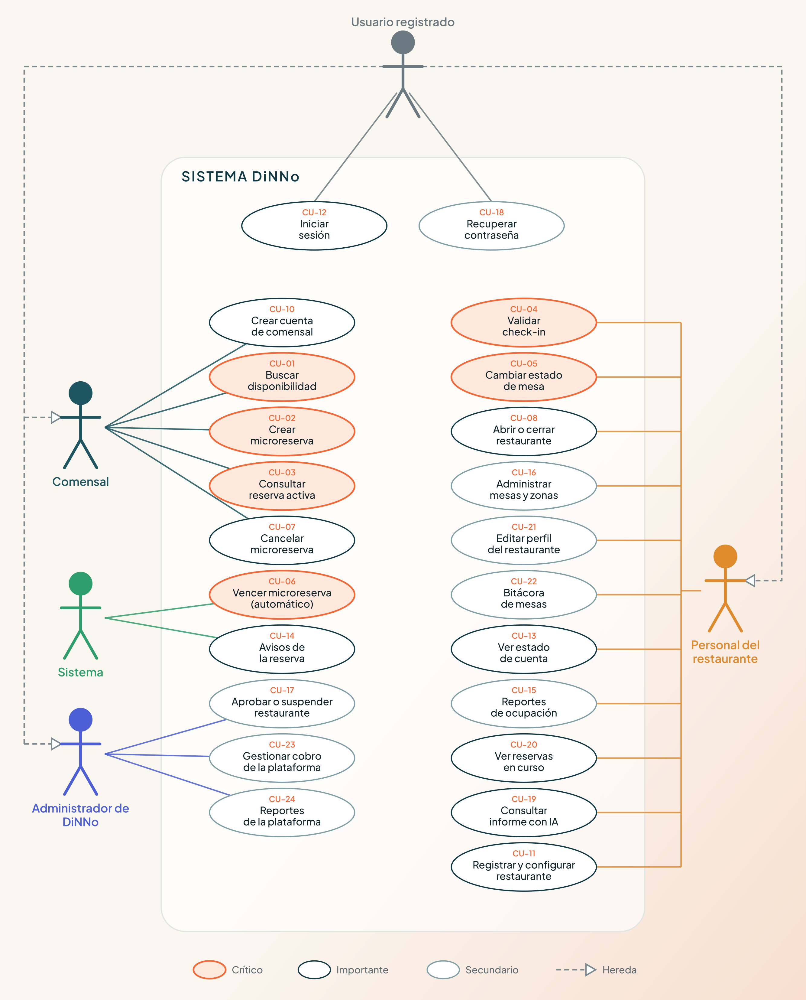
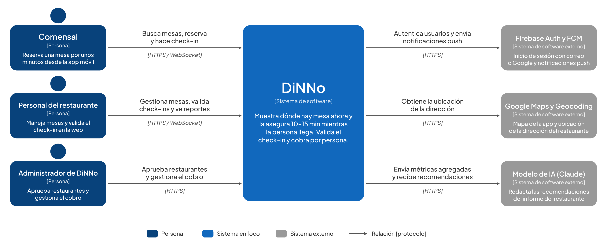
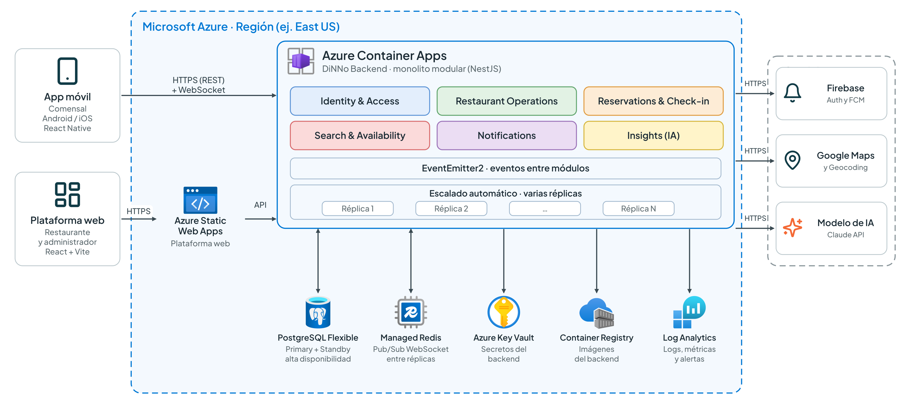
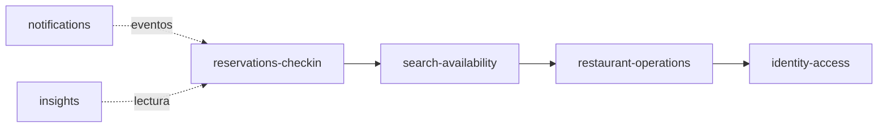
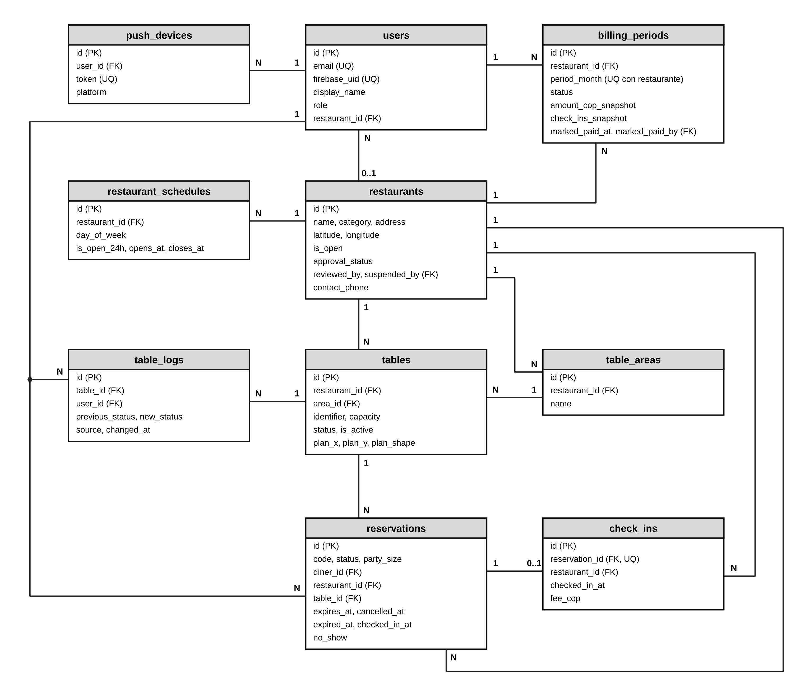

<div align="center">

# 📍 DiNNo · Backend

**Dile no a la espera.**
API REST y tiempo real para encontrar y asegurar una mesa disponible *ahora*.


</div>

## 📑 Contenido

| | | |
|---|---|---|
| [🧡 Qué es DiNNo](#-qué-es-dinno) | [🧩 Módulos](#-módulos) | [📁 Estructura](#-estructura-del-proyecto) |
| [🏗️ Arquitectura](#️-arquitectura) | [🛠️ Stack](#️-stack-tecnológico) | [🧪 Pruebas y calidad](#-pruebas-y-calidad) |
| [📡 API](#-api) | [🗄️ Modelo de datos](#️-modelo-de-datos) | [☁️ Despliegue](#️-despliegue) |
| [🔒 Concurrencia y seguridad](#-concurrencia-y-seguridad) | [🚀 Empezar en local](#-empezar-en-local) | [👥 Equipo](#-equipo) |

---

## 🧡 Qué es DiNNo

DiNNo es un servicio de **microreservas para restaurantes**. El comensal encuentra en la app móvil un restaurante con mesa disponible en este momento y la asegura mientras llega; el restaurante administra sus mesas desde la app web y confirma la llegada con un *check-in*.

- 💸 Se cobra por **comensal** con check-in (tarifa configurable; por defecto **COP 1.500**).
- 📍 Piloto en la **Calle 72, Bogotá**.
- ⏱️ La reserva dura un tiempo limitado y vence sola.

Este repositorio es el **backend**: la API que usan la [app móvil del comensal](https://github.com/DiNNo-team/mobile) y la [plataforma web del restaurante](https://github.com/DiNNo-team/frontend).

### 👥 Quién usa qué

| Actor | Qué hace | Cliente |
|---|---|---|
| 🍽️ **Comensal** (`diner`) | Busca restaurantes con disponibilidad, reserva, cancela y recibe notificaciones | App móvil |
| 🏪 **Administrador de restaurante** (`restaurant_admin`) | Administra mesas y plano, abre o cierra, hace check-in, consulta reportes e informe de IA | App web |
| 🛡️ **Administrador de plataforma** (`platform_admin`) | Aprueba, rechaza y suspende restaurantes; ve métricas y gestiona el cobro mensual | App web |

### 🎭 Casos de uso

<div align="center">



*Casos de uso de DiNNo por tipo de actor.*

</div>

### ✨ Funcionalidades

- Registro de restaurantes con **revisión y aprobación** por la plataforma.
- Gestión de **mesas, zonas, plano y bitácora** de cambios.
- **Búsqueda** por ubicación, categoría y número de personas, con disponibilidad en tiempo real.
- **Microreserva** con vigencia limitada, cancelación y vencimiento automático.
- **Check-in** por código o QR y cobro por comensal.
- **Reportes** del restaurante, panel del administrador y cobro mensual.
- **Informe de IA** con recomendaciones de los últimos 7 días (Claude).
- **Notificaciones push** y actualizaciones por **WebSocket**.

---

## 🏗️ Arquitectura

Monolito modular en **NestJS**: una sola aplicación desplegable, organizada en seis módulos con fronteras claras. Un único despliegue, transacciones locales sobre una sola base de datos y comunicación interna sin latencia de red.

<div align="center">



*Diagrama de contexto (C4): quién usa DiNNo y con qué servicios externos se comunica el backend.*



*Arquitectura de referencia de DiNNo en Microsoft Azure.*

</div>

> [!NOTE]
> El diagrama muestra la arquitectura de referencia, con varias réplicas y alta disponibilidad. El piloto opera con una réplica y PostgreSQL B1ms (ver [Despliegue](#-despliegue)).

### 🔌 Cómo se comunican las piezas

| Canal | Uso |
|---|---|
| **REST** sobre HTTPS (`/v1`) | Todas las operaciones de los clientes; token de Firebase en `Authorization: Bearer` |
| **WebSocket** (Socket.IO) | Disponibilidad en vivo para comensales; reservas y mesas para el restaurante |
| **Eventos internos** (EventEmitter2) | Desacoplan los módulos: publican tras confirmar la transacción y los *listeners* reaccionan |
| **Firebase Cloud Messaging** | Notificaciones push al comensal |
| **API de Claude** | Redacción del informe de IA a partir de métricas agregadas |
| **Google Geocoding API** | Direcciones a coordenadas |

### 🧱 Reglas de las fronteras

1. Las dependencias entre módulos **no tienen ciclos**.
2. La comunicación hacia atrás se hace con **eventos internos**.
3. Las reglas de negocio se expresan como **puertos** (interfaces) que cada módulo implementa.

Así, cualquier módulo puede extraerse a un servicio independiente sin reescribir los demás.

---

## 🧩 Módulos



| Módulo | Responsabilidad |
|---|---|
| 🔐 `identity-access` | Usuarios, verificación del token de Firebase, roles, aprobación y autenticación del WebSocket |
| 🏪 `restaurant-operations` | Perfil del restaurante, mesas, zonas, plano, bitácora, geocodificación y revisión por el administrador |
| 🔎 `search-availability` | Reglas de disponibilidad, búsqueda, detalle público, vigencia de reserva y gateway Socket.IO |
| 📅 `reservations-checkin` | Reserva, cancelación, vencimiento, check-in, cobro, reportes y panel del administrador |
| 🔔 `notifications` | Registro de dispositivos y notificaciones push (FCM) |
| 🤖 `insights` | Informe de IA del restaurante (solo lectura) |

Cada módulo separa **controladores, servicios, entidades, DTO, puertos y listeners**. Los servicios de dominio no conocen el gateway ni el proveedor de notificaciones: publican eventos y los listeners los reenvían.

---

## 🛠️ Stack tecnológico

| Capa | Tecnología |
|---|---|
| Entorno | Node.js 24 (ESM) · TypeScript 6 |
| Framework | NestJS 12 (common, core, config, typeorm, event-emitter, swagger) |
| Persistencia | TypeORM 1.1 · PostgreSQL 17 |
| Caché y contadores | Redis (ioredis 5) sobre Azure Managed Redis |
| Tiempo real | Socket.IO 4.8 |
| Autenticación y push | Firebase Authentication y Cloud Messaging (firebase-admin 14) |
| IA | Claude API (`@anthropic-ai/sdk`) |
| Seguridad | helmet · `@nestjs/throttler` · class-validator |
| Documentación | Swagger (OpenAPI) en `/docs` |
| Pruebas | Vitest · Supertest · socket.io-client · k6 |
| Calidad | oxlint · Prettier · TypeScript estricto |
| Nube y CI/CD | Azure Container Apps · ACR · Key Vault · GitHub Actions (OIDC) |

---

## 📡 API

Todas las rutas viven bajo **`/v1`** y la documentación interactiva está en **`/docs`** (Swagger).

> **Roles:** `RA` administrador de restaurante · `D` comensal · `PA` administrador de plataforma

<details>
<summary><b>🔐 identity-access</b></summary>

| Método | Ruta | Roles | Descripción |
|---|---|---|---|
| `GET` | `/me` | RA, D, PA | Identidad actual. Sin perfil → `403 PROFILE_REQUIRED` |
| `POST` | `/diners/me` | Cuenta Firebase verificada | Crea (201) o devuelve (200) el comensal |

</details>

<details>
<summary><b>🏪 restaurant-operations</b></summary>

| Método | Ruta | Roles | Descripción |
|---|---|---|---|
| `POST` | `/restaurants` | RA habilitado por el equipo | Registra el restaurante (nace `approved`) |
| `POST` | `/restaurants/signup` | Cuenta sin perfil | Crea usuario RA y restaurante `pending` en una transacción |
| `GET` `PATCH` | `/restaurants/me` | RA | Perfil y edición de datos, horarios y coordenadas |
| `POST` | `/restaurants/me/resubmit` | RA (rechazado) | Reenvía la solicitud |
| `GET` `PATCH` | `/restaurants/me/status` | RA | Abierto / cerrado |
| `POST` `GET` | `/tables` | RA aprobado | Crear y listar mesas |
| `PUT` | `/tables/plan` | RA aprobado | Reemplaza el plano completo |
| `PATCH` | `/tables/:id/status` | RA aprobado | Cambia estado; `409 TABLE_HAS_ACTIVE_RESERVATION` si hay reserva viva |
| `PATCH` | `/tables/:id` | RA aprobado | Edita identificador, capacidad o zona |
| `POST` | `/tables/:id/deactivate` · `/reactivate` | RA aprobado | Desactiva o reactiva |
| `GET` `POST` | `/table-areas` | RA aprobado | Listar y crear zonas |
| `PATCH` `DELETE` | `/table-areas/:id` | RA aprobado | Renombrar o eliminar zona |
| `GET` | `/table-logs?tableId=` | RA aprobado | Bitácora (hasta 200 filas) |
| `GET` | `/geocode?address=` | RA (también pendiente o rechazado), D, cuenta sin perfil con correo verificado | Dirección → coordenadas. `404 ADDRESS_NOT_FOUND` · `503 GEOCODING_UNAVAILABLE` |
| `GET` | `/admin/restaurants` · `/:id` | PA | Lista paginada y detalle |
| `POST` | `/admin/restaurants/:id/approve` · `reject` · `suspend` · `reactivate` | PA | Revisión del restaurante |

</details>

<details>
<summary><b>🔎 search-availability</b></summary>

| Método | Ruta | Roles | Descripción |
|---|---|---|---|
| `GET` | `/search/zones` | D | 20 zonas con coordenadas |
| `GET` | `/search/restaurants` | D | Búsqueda por ubicación o zona, radio (1, 2, 5 o 10 km), categoría y personas |
| `GET` | `/restaurants/:id/public` | D | Detalle público: horarios, `isOpenNow`, disponibilidad y vigencia |

</details>

<details>
<summary><b>📅 reservations-checkin</b></summary>

| Método | Ruta | Roles | Descripción |
|---|---|---|---|
| `POST` | `/reservations` | D | Crea la reserva. Errores 409: `NO_TABLE_AVAILABLE`, `ACTIVE_RESERVATION_EXISTS`, `RESTAURANT_CLOSED` |
| `GET` | `/reservations/active` | D | Reserva activa y hora del servidor |
| `GET` | `/reservations/:id` | D (propia) | Reserva en cualquier estado |
| `POST` | `/reservations/:id/cancel` | D (propia) | Cancela; `409 RESERVATION_NOT_ACTIVE` si ya no está activa |
| `POST` | `/restaurants/me/check-ins` | RA | Confirma la llegada con el código |
| `GET` | `/restaurants/me/reservations` · `/summary` | RA | Reservas, KPIs, mapa de calor y pago mensual |
| `GET` | `/restaurants/me/billing/check-ins` | RA | Estado de cuenta paginado |
| `GET` | `/admin/overview` · `/admin/billing` · `/admin/billing/:restaurantId` · `/admin/activity` · `/admin/platform/metrics` | PA | Panel de la plataforma |
| `POST` | `/admin/billing/:restaurantId/:month/mark-paid` · `mark-pending` | PA | Cobro mensual |

</details>

<details>
<summary><b>🔔 notifications · 🤖 insights · ❤️ salud</b></summary>

| Método | Ruta | Roles | Descripción |
|---|---|---|---|
| `PUT` `DELETE` | `/notifications/devices` | D | Registra o elimina el token del teléfono |
| `GET` | `/restaurants/me/insights?refresh=` | RA aprobado | Informe de IA (7 días frente a los 7 anteriores) |
| `GET` | `/health` | Público | Estado del servicio y commit desplegado |

</details>

### ⚡ Eventos

- **Internos** (EventEmitter2, tras confirmar la transacción): `reservation.created` · `reservation.cancelled` · `reservation.expired` · `reservation.checked_in` · `table.status-changed` · `restaurant.availability-affected`.
- **WebSocket** (Socket.IO): `availability.changed` (comensales) y `reservation.*` y `table.status_changed` (restaurante, o comensal en sus propias reservas).

---

## 🗄️ Modelo de datos

PostgreSQL con `uuid` como clave primaria y `created_at` / `updated_at` en todas las tablas. El esquema se gestiona **solo con migraciones** (`synchronize: false`) y las restricciones de integridad se declaran en la base de datos.

<div align="center">



*Modelo entidad-relación. `1` es el lado uno de la relación y `N` el lado muchos.*

</div>

| Campo | Valores |
|---|---|
| `users.role` | `restaurant_admin` · `diner` · `platform_admin` |
| `restaurants.approval_status` | `pending` · `approved` · `rejected` · `suspended` |
| `reservations.status` | `active` · `cancelled` · `expired` · `completed` |
| `tables.status` | `available` · `reserved` · `occupied` |
| `billing_periods.status` | `pending` · `paid` |

---

## 🔒 Concurrencia y seguridad

| Decisión | Por qué |
|---|---|
| Bloqueo de **una mesa a la vez** con `SKIP LOCKED` | Evita esperas entre reservas simultáneas y nunca bloquea todas las mesas de un restaurante |
| **Restricciones únicas parciales** en la base de datos | La integridad no depende solo de la aplicación |
| `UPDATE … WHERE` condicional con `RETURNING` | Cancelar, vencer, hacer check-in y revisar son atómicos sin transacciones largas |
| `expires_at` en PostgreSQL como fuente de verdad | Sin temporizadores en memoria; el estado sobrevive a reinicios |
| Monto guardado en `check_ins.fee_cop` | El historial no cambia si la tarifa cambia después |

- Autenticación con **Firebase**; el restaurante y el rol salen del usuario actual, nunca de lo que manda el cliente.
- **Límite de peticiones** por ruta y cabeceras de seguridad con **helmet**.
- Una prueba de arquitectura verifica que **toda ruta de administración** exija rol de plataforma y declare su límite.
- Ningún secreto en el repositorio: valores en **Key Vault** (Azure) y `.env` (local).

---

## 🚀 Empezar en local

### Requisitos

- Node.js **24**
- Una base **PostgreSQL 17** y un **Redis** accesibles
- Archivo `.env` (los **nombres** de las variables están en `.env.example`; los valores se piden al equipo)

### Pasos

```bash
git clone https://github.com/DiNNo-team/backend.git
cd backend
npm install
cp .env.example .env        # completa los valores con el equipo
npm run migration:run       # aplica las migraciones
npm run start:dev           # API en http://localhost:3000
```

| Recurso | URL local |
|---|---|
| Estado del servicio | http://localhost:3000/v1/health |
| Documentación Swagger | http://localhost:3000/docs |

> [!TIP]
> Tras cada `git pull`, corre `npm install` antes de cualquier otro comando.

### 🔑 Variables de entorno

Solo se documentan los **nombres**; nunca subas valores al repositorio.

<details>
<summary>Ver variables</summary>

| Variable | Uso |
|---|---|
| `DATABASE_URL` | Conexión a PostgreSQL (con `sslmode`) |
| `REDIS_URL` | Conexión a Redis |
| `CORS_ORIGINS` | Orígenes permitidos, separados por comas |
| `FIREBASE_PROJECT_ID` | Proyecto de Firebase |
| `FIREBASE_SERVICE_ACCOUNT_FILE` / `_JSON` | Credenciales de Firebase Admin |
| `GOOGLE_GEOCODING_API_KEY` | Geocodificación de direcciones |
| `RESERVATION_TTL_MINUTES` | Vigencia de una reserva |
| `RESERVATION_EXPIRY_ENABLED` | Barrido periódico de vencimientos |
| `CHECKIN_FEE_PER_GUEST_COP` | Tarifa por comensal (COP) |
| `INSIGHTS_LLM_API_KEY` / `INSIGHTS_LLM_MODEL` | Acceso y modelo del informe de IA |
| `PORT` | Puerto (por defecto 3000) |
| `GIT_COMMIT` · `RENDER_GIT_COMMIT` | Versión desplegada, expuesta en `/v1/health` (la define el pipeline; no se escribe a mano) |
| `RATE_LIMIT_ENABLED` / `RATE_LIMIT_FACTOR` | Límite de peticiones |
| `REALTIME_REDIS_ADAPTER_ENABLED` | Adaptador de Redis de Socket.IO (varias réplicas) |
| `TRUST_PROXY_HOPS` | Proxies de confianza para la IP del cliente |
| `PLATFORM_ADMIN_EMAIL` | Administrador de plataforma creado por el seed |
| `DEV_USER_ENABLED` / `DEV_USER_ID` | Usuario de desarrollo (solo local) |
| `FIREBASE_AUTH_EMULATOR_HOST` | Emulador de Firebase (solo local; nunca en un ambiente desplegado) |
| `TEST_DATABASE_URL` | Base para las pruebas con PostgreSQL real |

</details>

---

## 📁 Estructura del proyecto

| Carpeta o archivo | Contenido |
|---|---|
| 📂 `.github/workflows/` | Pipeline de integración y despliegue continuo |
| 📂 `ai-prototype/` | Prototipo en Python del informe de IA (datos sintéticos y métricas) |
| 📂 `docs/` | Documentación técnica (contratos, base de datos, Azure) |
| 📂 `docs/images/` | Diagramas del README: contexto C4, casos de uso, arquitectura en Azure y modelo entidad-relación |
| 📂 `load-tests/` | Pruebas de carga con k6 |
| 📂 `scripts/` | Utilidades de QA, escucha de eventos y consultas SQL |
| 📂 `src/common/` | Base de datos, DTO, eventos, filtros, límite de peticiones, seguridad y validación |
| 📂 `src/config/` | Redis, SSL de la base de datos y adaptador de Socket.IO |
| 📂 `src/migrations/` | 20 migraciones y sus pruebas |
| 📂 `src/modules/` | Los seis módulos de negocio |
| 📂 `src/seed-data/` · `src/scripts/` | Datos de ejemplo, exportación y reinicio de la demo |
| 📂 `test/` | Pruebas e2e y con PostgreSQL real (`test/db`) |
| 🐳 `Dockerfile` | Imagen de producción en dos etapas |
| 📄 `.env.example` | Nombres de las variables de entorno, sin valores secretos |

---

## 🧪 Pruebas y calidad

| Tipo | Comando | Casos | Alcance |
|---|---|---|---|
| Unitarias | `npm run test` | 1.664 | Servicios, reglas de dominio, guards, filtros, migraciones, listeners |
| E2E HTTP y WebSocket | `npm run test:e2e` | 757 | Controladores, validación, autorización, errores y tiempo real |
| PostgreSQL real | `npm run test:db` | 147 | Índices, restricciones, concurrencia de reserva, cobro y bitácora |

**Cobertura unitaria:** sentencias 93,04 % · funciones 90,80 % · líneas 93,17 % · ramas 75,58 %.

```bash
npm run lint        # oxlint
npm run typecheck   # TypeScript
npm run build
```

### 📈 Pruebas de carga (k6)

`load-tests/dinno.k6.js` define tres escenarios (navegar, reservar y tiempo real) y tres perfiles: **humo** (~1 min), **carga** (5 min, hasta 50 usuarios y 200 sockets) y **estrés** (7 min, hasta 400 usuarios y 1.000 sockets).

---

## ☁️ Despliegue

| Recurso Azure | Configuración |
|---|---|
| **Container Apps** | 0,5 vCPU · 1 GiB · HTTPS · WebSocket por el mismo puerto · 1 réplica |
| **Container Registry** | SKU Basic, acceso por identidad administrada |
| **PostgreSQL Flexible Server** | B1ms · PostgreSQL 17 · 32 GB |
| **Managed Redis** | Balanced B0 · TLS |
| **Key Vault** | Autorización RBAC |
| **Log Analytics** | Retención de 30 días |

### 🔄 CI/CD (GitHub Actions)

| Job | Cuándo | Qué hace |
|---|---|---|
| ✅ `checks` | Pull request y push | `lint` → `typecheck` → `test` → `test:e2e` → `build` |
| 🚢 `deploy-azure` | Push a `develop`, tras `checks` | Construye la imagen, la publica en ACR, actualiza el Container App y espera a que `/v1/health` devuelva el nuevo commit |
| 🔍 `verify-deployment` | Push a `develop`, tras `checks` | Comprueba que Render (plan B) sirve el commit y lo registra como *deployment* de GitHub |

- Autenticación **sin secretos** (OIDC): la identidad solo confía en este repositorio y la rama `develop`.
- El despliegue termina en éxito **solo cuando la versión nueva responde**.

> [!IMPORTANT]
> `develop` se despliega sola. **Nada se sube directo a `develop`: todo entra por Pull Request revisado.**

---

## 👥 Equipo

**Equipo DiNNo** · Escuela Colombiana de Ingeniería Julio Garavito

| Integrante | Rol | GitHub |
|---|---|---|
| Elizabeth Correa Suárez | Backend base, mesas, edición del restaurante e integración | [@Eliza-05](https://github.com/Eliza-05) |
| Juan Sebastián Ortega Muñoz | Kit visual y pantallas de mesas; notificaciones y límite de peticiones del backend | <!-- usuario --> |
| Jacobo Díaz | Autenticación y control de acceso | [@Jacobo2025](https://github.com/Jacobo2025) |
| Santiago Carmona | Registro del restaurante (onboarding); informe de IA | <!-- usuario --> |
| Sergio Alejandro Idarraga Torres | Estado abierto/cerrado y bitácora de mesas; informe de IA | <!-- usuario --> |

---

<div align="center">

**DiNNo** · *Dile no a la espera.* 🧡

</div>